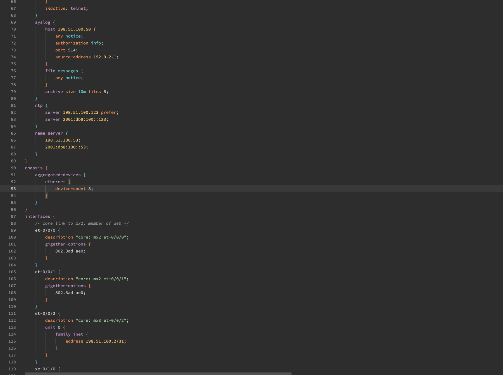

# Juniper Junos for Zed

Syntax highlighting, bracket matching, indentation and an outline for
Juniper Junos configuration: show configuration, display set, groups and annotations.



| Output | Example |
|---|---|
| `show configuration` | `system { host-name mx1; }` |
| `show configuration | display set` | `set interfaces et-0/0/0 unit 0 family inet address 198.51.100.0/31` |
| Annotations and modifiers | `inactive: web-management { ... }` |
| Secrets and omitted groups | `encrypted-password "$6$..."; ## SECRET-DATA` |

## Install

In Zed, open the Extensions page (`zed: extensions`), search for
"Juniper Junos" and select Install.

Zed uses this language for `*.junos`, `*.jcfg`, `*.juniper` files, and for any file whose first line
matches `^(## Last (commit|changed): |set version )`. To use it for other files, add a
`file_types` entry in your Zed settings:

```json
{ "file_types": { "Juniper Junos": ["*.cfg"] } }
```

## Highlighting

Every word gets the capture of its YANG node kind, so a container, a leaf and
the leaf's value have different colors:

| Word | Capture |
|---|---|
| YANG container or list name | `@keyword` |
| YANG leaf or leaf-list name | `@property` |
| enumeration value, identity or boolean | `@variant (fallback @constant)` |
| integer or decimal | `@number` |
| IPv4/IPv6 address or prefix, MAC address | `@string.special` |
| any other bare word: port ids, names, key values | `@variable` |
| quoted string | `@string` |
| CLI verb at the start of a statement | `@keyword.control (fallback @keyword)` |
| statement annotation such as inactive: | `@attribute` |
| # line comment or /* block comment */ | `@comment` |

## How it is built

The grammar lives in [tree-sitter-junos](https://github.com/scotho3/tree-sitter-junos).
Both repositories are generated by [yang-cli-grammar-builder](https://github.com/scotho3/yang-cli-grammar-builder)
from the vendor's published YANG models. Report problems and send changes
there.

## License

Apache License 2.0; see [LICENSE](LICENSE).
